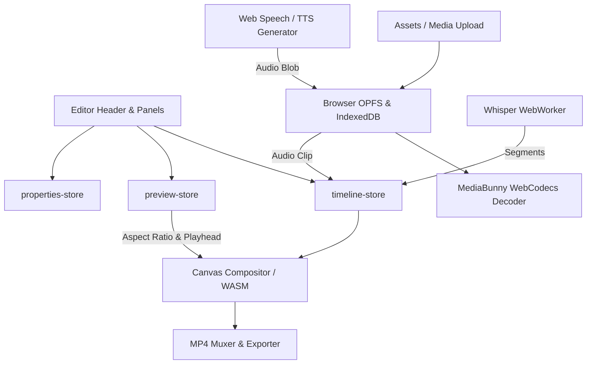

# Design Specification: OpenCut Creator Studio (Custom Version)

**Date:** 2026-10-13  
**Status:** Approved by User  
**Foundation Base:** `OpenCut-0.3.0` (from `~/Downloads/OpenCut-0.3.0`)  
**Target Repository:** `/Users/allanindrajith/Github Project/OpenCut`

---

## 1. Executive Summary

This specification outlines the architecture, component structure, data flow, and feature enhancements for **OpenCut Creator Studio**—a custom, privacy-focused, browser-based video editing suite designed specifically for modern short-form and general content creators. 

While preserving the battle-tested multi-track engine from OpenCut v0.3.0 (Next.js, Turbopack, WebCodecs, MediaBunny, WASM compositor, and WebWorker Whisper transcription), this custom version transforms the experience by introducing:
1. **Zero-Docker local-first architecture:** Runs entirely in the client with IndexedDB and OPFS storage; no database or Redis setup required for desktop or local web development.
2. **Short-Form & Social Media Creator Suite:** Instant aspect ratio presets (9:16 vertical, 1:1 square, 4:5 portrait, 16:9 landscape) paired with interactive UI Safe-Zone Overlays for TikTok, Instagram Reels, and YouTube Shorts.
3. **AI Captioning & Subtitle Styles:** Automatic audio-to-text pipeline that generates synchronized, editable subtitle tracks with creator-tier typographic presets (e.g. MrBeast-style bold yellow, high-contrast outlines, animations).
4. **AI Text-to-Speech (TTS) Voiceover Generator:** In-app audio synthesis supporting customizable voices, speed, and pitch that drops generated voiceover clips directly onto timeline audio tracks.
5. **Silence Trimmer / Smart Cut:** Waveform analysis tool that automatically detects dead air and silence below threshold decibels for 1-click batch cutting.
6. **Obsidian Studio UI:** Refined dark-studio aesthetic (`#0B0D11`), glassmorphism panels, and optimized quick-export presets.

---

## 2. Base Codebase Ingestion & Structure

### 2.1 Synchronization Strategy
The current repository root (`/Users/allanindrajith/Github Project/OpenCut`) was initialized with an early rewrite scaffold where the editor is incomplete. We will ingest the complete working application from `~/Downloads/OpenCut-0.3.0`, synchronizing the full working tree:
* Root configuration: `package.json`, `bun.lock`, `turbo.json`, `biome.json`, `tsconfig.json`.
* `apps/web`: The Next.js 16 / React 19 web application containing the complete timeline, canvas renderer, dialogs, and components.
* `rust/`: The GPU compositor and WASM build pipeline used by `opencut-wasm`.
* `docs/`: System documentation and architectural references.

### 2.2 Decoupled Local-First Mode
In standard OpenCut 0.3.0, server-side auth (BetterAuth) and cloud project syncing rely on PostgreSQL and Redis via Docker Compose. For this custom edition:
* All editor routes (`/editor`, `/`) check for local storage / IndexedDB as the primary persistence layer.
* Serverless/database checks are non-blocking; the application initializes in standalone offline mode with full editing, caching, and export functionality without running Docker.

---

## 3. Architecture & Tech Stack

* **Framework:** Next.js 16 with Turbopack (`next dev --turbopack`)
* **UI Runtime:** React 19, Radix UI Primitives, Lucide & HugeIcons
* **Styling & Theme:** Tailwind CSS v4, `@tailwindcss/postcss`, next-themes (Obsidian Dark Studio palette)
* **Animation & Gestures:** Motion (`motion/react`), `@hello-pangea/dnd`
* **State Management:** Zustand stores (`timeline-store`, `preview-store`, `editor-store`, `properties-store`)
* **Video & Audio Processing:**
  * **MediaBunny & WebCodecs:** Frame decoding, demuxing, and hardware-accelerated video rendering.
  * **WASM Engine (`opencut-wasm`):** Frame compositing, blending modes, color correction, and filters.
  * **SoundTouchJS & WaveSurfer.js:** Audio pitch shifting, stretching, and real-time waveform visualization.
* **AI & Machine Learning:**
  * **Transcription:** `@huggingface/transformers` running OpenAI Whisper Tiny/Base inside a dedicated WebWorker.
  * **Text-to-Speech:** Web Speech API + Edge TTS client synthesis.

---

## 4. Feature Specifications

### 4.1 Social & Short-Form Studio Controls

#### Aspect Ratio Switcher
* Located in the editor preview toolbar.
* Available Presets:
  * `9:16` (1080 × 1920) — TikTok, Instagram Reels, YouTube Shorts
  * `1:1` (1080 × 1080) — Instagram Feed, Square Video
  * `4:5` (1080 × 1350) — Instagram Portrait
  * `16:9` (1920 × 1080) — YouTube, Desktop, TV
* **Fit / Fill / Blur Background Options:** When clips with differing aspect ratios are placed onto the canvas, users can choose:
  * *Fit:* Letterbox / pillarbox.
  * *Fill:* Zoom and crop to fill canvas.
  * *Blur Background:* Duplicates clip underneath with a 24px gaussian blur and brightness reduction.

#### Interactive Social Safe-Zone Overlays
* A preview overlay toggle button in the preview control bar.
* Overlays simulate platform interface elements with a semi-transparent guide:
  * **TikTok Mode:** Right sidebar (like, comment, share, bookmark, audio disc), bottom 160px (caption, sound title), top 100px (live / following tabs).
  * **Instagram Reels Mode:** Right sidebar icons, bottom 180px (audio attribution and caption).
  * **YouTube Shorts Mode:** Bottom bar (subscribe, title, channel name), right sidebar (like, dislike, comment, remix).
* Renders non-intrusively and automatically hidden during video export.

---

### 4.2 AI Creator Suite

#### Timeline Auto-Captions
* **Trigger:** Available in the Assets Panel under "Captions" or via timeline context menu on any selected video/audio clip.
* **Processing:**
  1. Selected clip's audio buffer is extracted.
  2. Audio data (`Float32Array`) is transferred to the Whisper WebWorker (`transcription/worker.ts`).
  3. Worker emits transcription segments containing `{ start, end, text }`.
* **Timeline Insertion:**
  1. A new `Track` of type `text` is automatically created with label `Captions`.
  2. For each segment, a text clip entity is created with matching `start` and `duration`.
  3. Default typography style is applied from the selected preset:
     * *MrBeast Bold:* All-caps, bold sans-serif, vivid yellow fill `#FFE500`, 3px black stroke, heavy drop shadow.
     * *Neon Glow:* Cyan `#00F0FF` fill with cyan outer glow.
     * *Subtle White:* Clean white text with translucent black pill badge background.
* Users can edit individual subtitle text, split, adjust timing, or re-style globally from the Properties panel.

#### Text-to-Speech (TTS) Voiceover Generator
* **Panel Location:** Assets sidebar tab "Voiceover / TTS".
* **Inputs:**
  * Script text textarea (supports multi-line dialogue).
  * Voice selector: system voices + synthesized neutral voices.
  * Speech rate slider (0.5x to 2.0x), pitch slider (-10 to +10).
* **Generation & Placement:**
  1. User can click "Preview Audio" to listen before adding.
  2. Clicking "Add to Timeline" renders the audio into an audio buffer / blob.
  3. Audio file is written to local OPFS cache.
  4. An `AudioElement` is added to the active audio track at the current playhead position.

#### Smart Silence Remover
* **Trigger:** Toolbar action on any selected audio or video clip: "Remove Silences".
* **Mechanism:**
  1. Scans the decoded audio buffer RMS (Root Mean Square) volume in 50ms windows.
  2. Identifies contiguous regions where volume is below threshold (default: -35 dB) lasting longer than minimum duration (default: 0.4s).
  3. Computes slice boundaries and performs non-destructive clip splitting and removal in `timeline-store`.
  4. Automatically ripples subsequent clips leftward to eliminate dead air.

---

### 4.3 UI Reskin & UX Enhancements

* **Theme Tokens:**
  * Studio Background: `#0B0D11`
  * Surface Secondary: `#14181F`
  * Panel Borders: `#1E242E`
  * Accent Primary: `#00E5FF` (Neon Cyan)
  * Accent Secondary: `#7C3AED` (Electric Violet)
  * Timeline Playhead: `#FF3366` (Hot Red)
* **Quick Export Presets:**
  * Direct one-click profiles in `export-button.tsx`:
    * *TikTok / Shorts Optimal (1080x1920, 60fps, MP4 H.264)*
    * *YouTube 1080p (1920x1080, 60fps, MP4 H.264)*
    * *YouTube 4K (3840x2160, 60fps, MP4 H.264)*
    * *Short GIF Animation (Auto-crop, 24fps)*

---

## 5. Data Flow & Store Architecture

---

## 6. Error Handling & Resilience

1. **Unsupported Codecs:**
   * Handled gracefully via MediaBunny error boundaries; prompts user to transcode or falls back to standard HTML5 `<video>` decoding if WebCodecs fails on specific MP4/MKV profiles.
2. **AI Model Download Failures:**
   * Displays non-blocking progress bars in the Captions panel with cancel options.
   * If memory limit is reached or connection drops, displays a toast notification and allows manual subtitle upload (`.srt`, `.vtt`) as a fallback.
3. **Local Storage Autosave Journal:**
   * Timeline actions debounce-save into browser IndexedDB every 5 seconds.
   * If tab is refreshed or crashes, user is greeted with a "Restore previous session" toast with timestamp.

---

## 7. Verification & Acceptance Criteria

1. **Codebase Migration:**
   * All directories from `~/Downloads/OpenCut-0.3.0` copied and verified in `/Users/allanindrajith/Github Project/OpenCut`.
   * Project installs cleanly via `bun install`.
   * Dev server boots successfully via `bun dev` (or `bun dev:web`) without requiring Docker/Redis.
2. **Functional Editor Verification:**
   * Timeline allows importing media, video scrubbing, splitting clips, moving playhead, and rendering canvas.
   * Aspect ratio switcher toggles between 9:16, 1:1, 4:5, and 16:9, updating canvas dimensions correctly.
   * Safe-zone overlays display properly on 9:16 canvas.
   * Auto-captions generate styled text clips on the timeline.
   * Text-to-speech voiceover adds an audio clip to the timeline.
   * Export button produces a valid, playable MP4 video.
